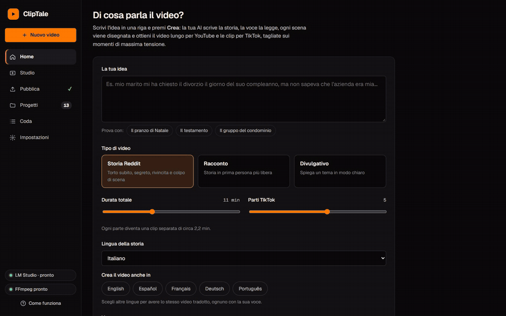
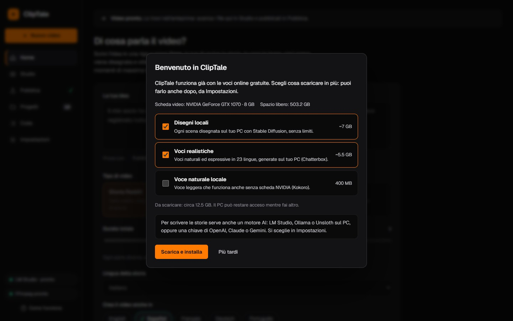
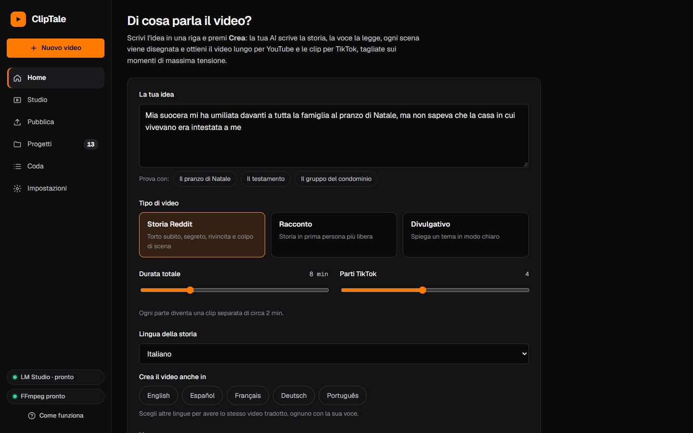
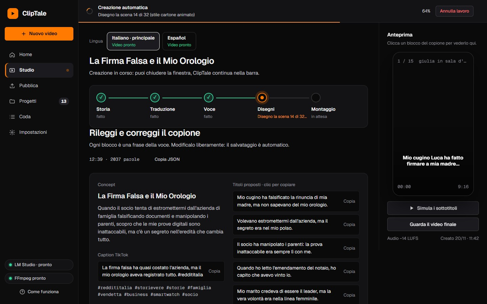
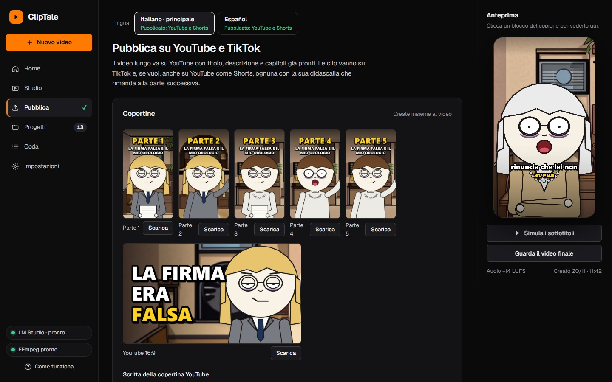
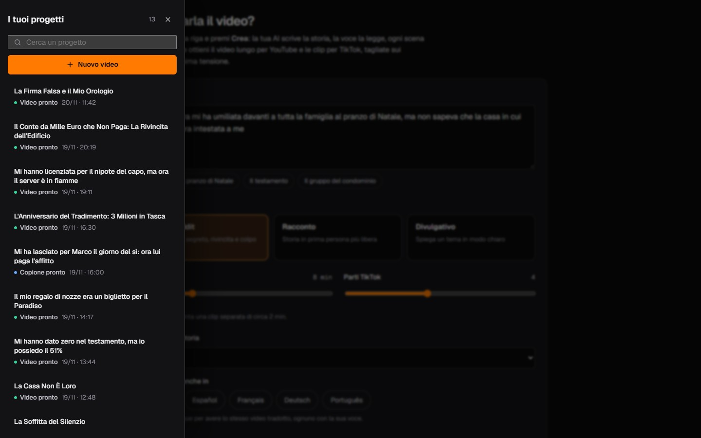
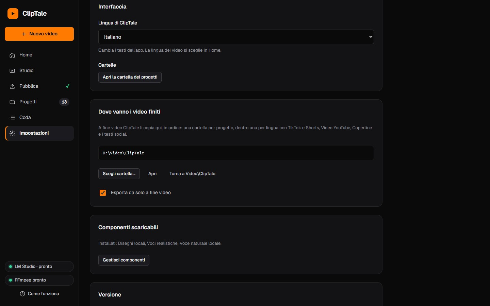

<p align="center">
  
</p>

<p align="center">
  <a href="https://github.com/Vincisus/ClipTale/releases/latest"></a>
  
  
  <a href="https://paypal.me/dammilpizzo"></a>
</p>

<h3 align="center">
  <a href="https://github.com/Vincisus/ClipTale/releases/latest">⬇&nbsp; Scarica ClipTale per Windows</a>
</h3>

<p align="center">
  Scrivi un'idea in una riga. ClipTale scrive la storia, la legge con una voce, disegna ogni scena e monta<br>
  il video lungo per YouTube e una clip per ogni parte per TikTok e Shorts, con titoli, descrizioni e copertine.<br>
  Lavora sul tuo PC, anche in più lingue insieme.
</p>

<br>

<p align="center">
  
</p>

<br>

## Installa ClipTale in 6 passi

**1. Scarica l'installer.** Apri la pagina [**Ultima versione**](https://github.com/Vincisus/ClipTale/releases/latest) e, sotto *Assets*, clicca **`ClipTale-Setup-x.y.z.exe`** (circa 23 MB).

**2. Avvialo.** Windows può mostrare *«PC protetto da Windows»*, perché l'installer non ha una firma a pagamento. Clicca **Ulteriori informazioni** e poi **Esegui comunque**. Accetta il permesso di amministratore: ClipTale va in `C:\Program Files\ClipTale`.

**3. Scegli la lingua e il collegamento sul desktop**, poi **Installa**. A fine installazione lascia la spunta su *Avvia ClipTale*.

**4. Aspetta la prima preparazione.** Solo la prima volta una piccola finestra arancione scarica Python e le librerie di ClipTale (circa 300 MB, qualche minuto). Serve la connessione a Internet.

**5. Scegli cosa scaricare in più.** La finestra di benvenuto mostra la tua scheda video e lo spazio libero. ClipTale funziona già con le voci online gratuite; i disegni e le voci sul tuo PC si aggiungono qui o più tardi da *Impostazioni*.

<p align="center"></p>

**6. Collega un motore AI**, che scrive le storie. In *Impostazioni › Motore AI* scegli:

| Sul tuo PC, gratis | Online, con una tua chiave API |
|---|---|
| [LM Studio](https://lmstudio.ai) con il server locale acceso (porta 1234) | OpenAI |
| [Ollama](https://ollama.com) | Claude (Anthropic) |
| Unsloth Studio (la scheda video va liberata a mano: l'app ti avvisa) | Gemini (Google) |

Fatto: scrivi la tua prima idea e premi **Crea**.

<br>

## Come si lavora

<table>
  <tr>
    <td width="50%" valign="top">
      <h3>1 · Home</h3>
      L'idea in una riga, il tipo di video (storia Reddit, racconto, divulgativo), la durata, le parti per TikTok e le lingue. Premi <b>Crea</b>, oppure <b>Aggiungi alla coda</b> per metterne in fila altri.
      <br><br>
    </td>
    <td width="50%" valign="top">
      <h3>2 · Studio</h3>
      Ci arrivi da solo appena premi Crea. Segui le fasi: storia, traduzione, voce, disegni, montaggio. Poi rileggi il copione, correggi una frase e rifai il video.
      <br><br>
    </td>
  </tr>
  <tr>
    <td width="50%" valign="top">
      <h3>3 · Pubblica</h3>
      A video pronto ClipTale ti porta qui. Video su YouTube con titolo, capitoli e copertina; clip su TikTok e come Shorts, ognuna con la sua didascalia. Lingua per lingua.
      <br><br>
    </td>
    <td width="50%" valign="top">
      <h3>I tuoi progetti</h3>
      Il pulsante <b>Progetti</b> apre il pannello con tutti i video, con la ricerca. Un clic e riprendi da dove eri.
      <br><br>
    </td>
  </tr>
</table>

Chiudendo la finestra ClipTale resta nell'icona arancione vicino all'orologio e continua a lavorare: l'icona mostra l'avanzamento e un avviso di Windows ti dice quando il video è pronto.

<br>

## Cosa ottieni

<table>
  <tr>
    <td width="34%" valign="top" align="center">
      
    </td>
    <td valign="top">
      Per ogni lingua scelta, a fine video ClipTale riordina tutto nella cartella che scegli (di base <code>Video\ClipTale</code>):

<pre>
La Firma Falsa e il Mio Orologio/
├── Italiano/
│   ├── TikTok e Shorts/     Parte 1.mp4 … Parte 5.mp4
│   ├── Video YouTube/       il video intero + sottotitoli .srt
│   ├── Copertine/           YouTube.jpg, TikTok parte 1.jpg …
│   └── Testi social.txt     titoli, descrizioni, tag e didascalie
└── Spagnolo/
    └── …
</pre>

- Video verticali 1080×1920, 30 fps, sottotitoli parola per parola.
- Clip tagliate nel momento di massima tensione, ognuna rimanda alla successiva.
- Stessi disegni in tutte le lingue: italiano, inglese, spagnolo, francese, tedesco, portoghese.


    </td>
  </tr>
</table>

<br>

## Cosa serve

| | Minimo | Per disegni e voci sul PC |
|---|---|---|
| **Sistema** | Windows 10 o 11, 64 bit | uguale |
| **Scheda video** | nessuna | NVIDIA con 6 GB o più (provata su GTX 1070, 8 GB) |
| **Spazio su disco** | circa 1 GB | fino a 13 GB in più |
| **Internet** | per la prima apertura, le voci online e i motori AI online | per scaricare i componenti, poi non più |
| **Motore AI** | uno dei sei qui sopra | uguale |

Su una GTX 1070 una storia di 2 minuti richiede circa 6 minuti, una di 8 minuti circa 15-20.

<br>

## Aggiornamenti

ClipTale controlla da solo se c'è una versione nuova. Quando c'è compare un avviso arancione nella barra a sinistra: clicca **Aggiorna adesso** (anche da *Impostazioni › Versione*). L'app scarica la nuova versione, la installa e si riapre. I tuoi progetti, i componenti scaricati e le impostazioni restano.

<br>

## Domande frequenti

<details>
<summary><b>Windows dice che l'app potrebbe essere pericolosa. È normale?</b></summary>
<br>
Sì. SmartScreen avvisa per i programmi senza una firma digitale a pagamento. Clicca <b>Ulteriori informazioni › Esegui comunque</b>. Il codice dell'app è tutto in questo repository.
</details>

<details>
<summary><b>Devo pagare qualcosa?</b></summary>
<br>
No. ClipTale è gratis. Paghi solo se scegli tu un servizio online a pagamento: un motore AI con chiave API, oppure ElevenLabs per le voci.
</details>

<details>
<summary><b>I miei testi escono dal computer?</b></summary>
<br>
Con un motore AI sul PC (LM Studio, Ollama, Unsloth), i disegni locali e le voci Chatterbox o Kokoro, no. Le voci online gratuite mandano il testo da leggere a Microsoft; i motori AI online e ElevenLabs lo mandano al loro servizio. Le chiavi API restano sul tuo PC.
</details>

<details>
<summary><b>Il motore AI non risponde.</b></summary>
<br>
Con LM Studio: apri la scheda <i>Developer</i>, carica un modello e premi <i>Start server</i> (porta 1234). ClipTale riprova da solo ogni 5 secondi. Con un servizio online controlla la chiave in <i>Impostazioni</i>.
</details>

<details>
<summary><b>Come collego YouTube e TikTok?</b></summary>
<br>
Una volta sola, dalla schermata <i>Pubblica</i>, che spiega i passaggi.<br><br>
<b>YouTube:</b> in Google Cloud Console crea un progetto, attiva <i>YouTube Data API v3</i>, crea un <i>ID client OAuth</i> di tipo <i>App desktop</i> e incolla Client ID e secret. Finché Google non verifica il progetto, i video caricati restano privati: li rendi pubblici da YouTube Studio.<br><br>
<b>TikTok:</b> su developers.tiktok.com crea un'app <i>Desktop</i> con <i>Login Kit</i> e <i>Content Posting API</i>. Le clip arrivano come bozze nell'app TikTok e le pubblichi con un tocco.
</details>

<details>
<summary><b>Come lo disinstallo?</b></summary>
<br>
Da <i>Impostazioni di Windows › App</i>. Il disinstallatore chiede se togliere anche i componenti scaricati; i video nella tua cartella non vengono mai toccati.
</details>

<br>

## Per chi sviluppa

L'app è un server locale FastAPI con l'interfaccia in `app/web/index.html`, aperta in una finestra WebView2 (`desktop/launcher.py`).

```powershell
.\Avvia.bat                              # prima volta: crea .venv con Python 3.12 e installa le dipendenze
python desktop\build_installer.py        # ClipTale.exe + installer (serve Inno Setup 6)
python desktop\build_i18n.py             # lingue dell'interfaccia da app\web\i18n\source
```

Per pubblicare una versione: alza `VERSION` in `app/core/desktop.py`, costruisci l'installer e allegalo a una nuova release `vX.Y.Z`. Le app installate la trovano da sole.

<br>

## Sostieni ClipTale

ClipTale è gratis e resta gratis. Se ti fa risparmiare ore di lavoro, puoi offrire un caffè a chi lo sviluppa: aiuta a pagare il tempo per le prossime versioni.

<p align="center">
  <a href="https://paypal.me/dammilpizzo"></a>
</p>

<br>

<p align="center"><sub>ClipTale usa <a href="https://github.com/astral-sh/uv">uv</a>, <a href="https://github.com/resemble-ai/chatterbox">Chatterbox</a>, <a href="https://huggingface.co/Lykon/dreamshaper-8">DreamShaper 8</a>, Kokoro, FFmpeg e pywebview, ognuno con la sua licenza.</sub></p>
